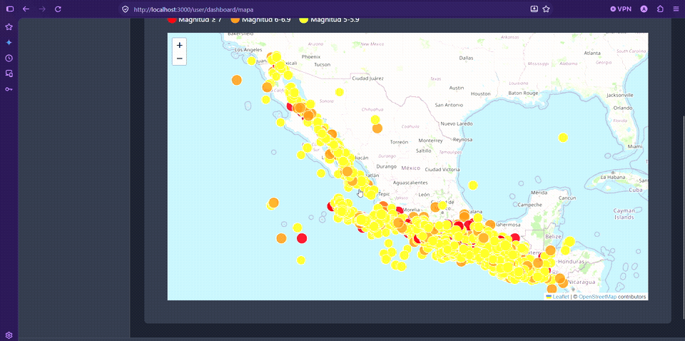
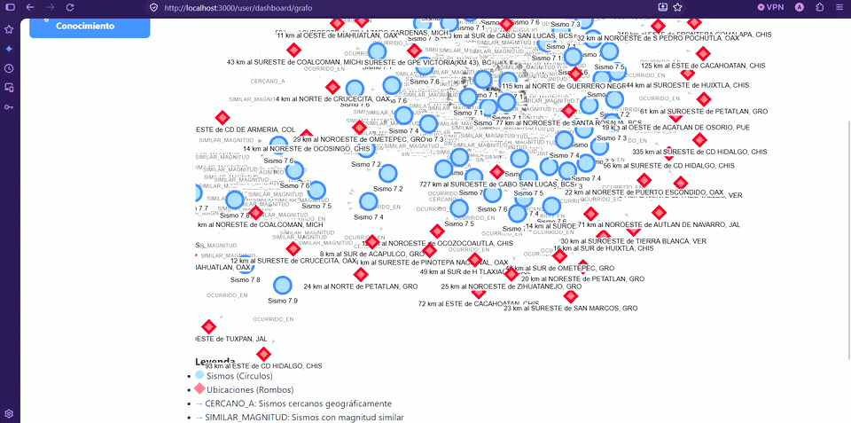
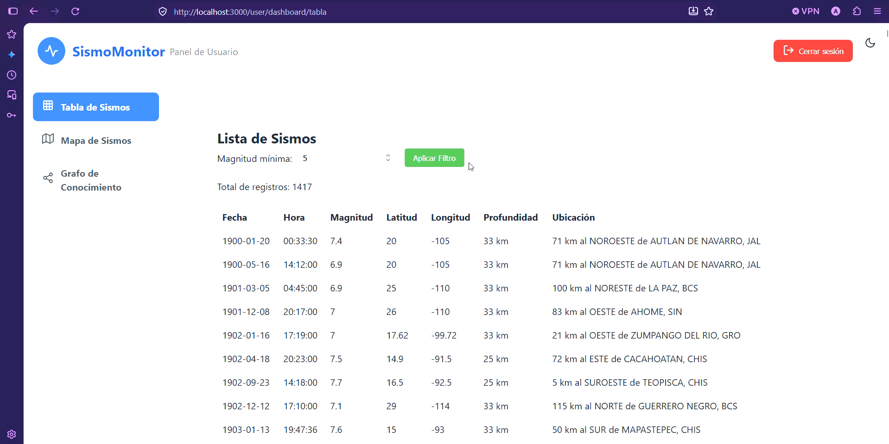
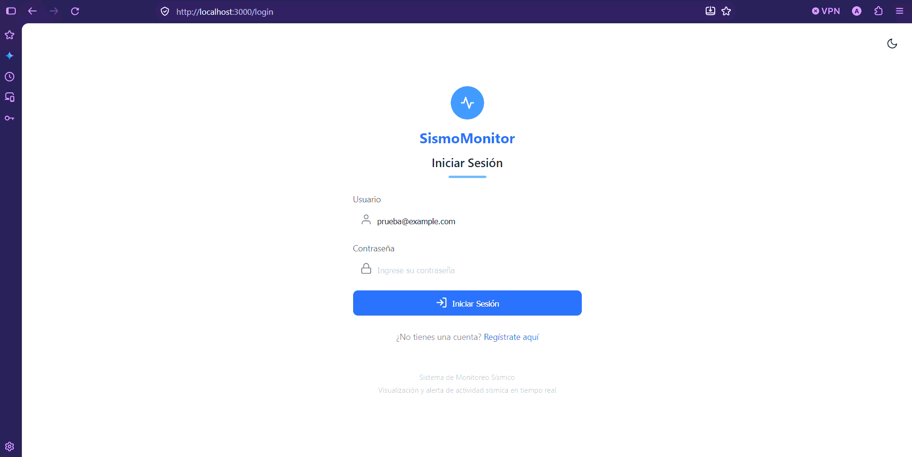

<p align="center">
  
  
  
  
  
  
  
  
</p>

# 🌍 SismoMonitor — Sistema de Visualización y Simulación Sísmica

> **Plataforma Full-Stack (Web React + Móvil Expo + Backend Spring Boot)** para la consulta, visualización geográfica, simulación de propagación de ondas sísmicas y modelado en grafos de relaciones territoriales y de magnitud en tiempo real e histórico.

---

## 📋 Tabla de Contenidos

- [Demostración en Video y Animaciones](#-demostración-en-video-y-animaciones)
- [Características Principales](#-características-principales)
- [Arquitectura del Sistema](#-arquitectura-del-sistema)
- [Tecnologías Utilizadas](#-tecnologías-utilizadas)
- [Estructura del Proyecto](#-estructura-del-proyecto)
- [Instalación y Despliegue](#-instalación-y-despliegue)
- [Credenciales y Acceso](#-credenciales-y-acceso)
- [Endpoints de la API](#-endpoints-de-la-api)
- [Seguridad](#-seguridad)

---

## 🎬 Demostración en Video y Animaciones

### 1. 🌊 Simulación de Propagación de Ondas Sísmicas
Simulación interactiva basada en modelos de velocidad de propagación de ondas **P** (primarias) y **S** (secundarias) sobre mapa geográfico interactivo con estaciones de monitoreo sísmico.

<p align="center">
  
</p>

> 📹 **[Ver video completo en alta resolución (MP4)](docs/demo/demo-propagacion-ondas.mp4)**

---

### 2. 🕸️ Grafo de Conocimiento Sísmico (Neo4j 2D / 3D)
Modelado de relaciones complejas en **base de datos orientada a grafos (Neo4j)**: eventos sísmicos vinculados por proximidad territorial (`OCURRIDO_EN`, `CERCANO_A`) y agrupaciones por intensidad (`SIMILAR_MAGNITUD`), con exploración interactiva 2D y 3D.

<p align="center">
  
</p>

> 📹 **[Ver video completo en alta resolución (MP4)](docs/demo/demo-grafo-neo4j.mp4)**

---

### 3. 📊 Dashboard de Usuario y Filtrado Dinámico de Sismos
Consulta tabular de eventos históricos con filtrado reactivo en tiempo real por umbrales de magnitud, coordenadas, profundidad y ubicación.

<p align="center">
  
</p>

---

### 4. 🔐 Autenticación, Sesiones y Modo Oscuro
Flujo de inicio de sesión y registro de usuarios con cifrado seguro BCrypt, control de roles (RBAC) y soporte de tema claro/oscuro.

<p align="center">
  
</p>

---

## ✨ Características Principales

* **Visualización Geoespacial Avanzada:** Mapas interactivos con Leaflet, marcadores dinámicos agrupados por severidad y coordenadas georreferenciadas.
* **Simulador Físico de Ondas:** Cálculo de tiempos de llegada y radio de impacto de ondas mecánicas P y S a estaciones sísmicas.
* **Red de Conocimiento con Neo4j:** Exploración visual de nodos (Sismo, Ubicación, Estación) y aristas con Cypher y Spring Data Neo4j.
* **Múltiples Clientes Multiplataforma:**
  * **Web:** Single Page Application (SPA) responsiva con React 19 y Vite.
  * **Móvil:** Cliente nativo para Android e iOS desarrollado con React Native / Expo SDK 55.
* **Gestión y Seguridad (RBAC):**
  * Rol `ROLE_USER`: Consulta de tabla, mapa, simulador y grafos.
  * Rol `ROLE_ADMIN`: Carga masiva de datasets CSV, sincronización con Neo4j y gestión de cuentas de usuario.
* **Despliegue Contenedorizado:** Entorno multi-servicio orquestado con Docker Compose.

---

## 🏗️ Arquitectura del Sistema

```
┌─────────────────────────────────┐       ┌─────────────────────────────────┐
│       Frontend Web (React 19)   │       │     App Móvil (Expo SDK 55)     │
│       Vite + Leaflet Maps       │       │    React Native + Navigation    │
└────────────────┬────────────────┘       └────────────────┬────────────────┘
                 │                                         │
                 │              HTTP / REST                │
                 └───────────────────┬─────────────────────┘
                                     │
                                     ▼
                  ┌─────────────────────────────────────┐
                  │      API Backend (Spring Boot 3)    │
                  │  Spring Security · MVC Controllers  │
                  └──────────────┬───────────────┬──────┘
                                 │               │
                 Spring Data JPA │               │ Spring Data Neo4j
                                 ▼               ▼
                  ┌──────────────────┐   ┌──────────────────┐
                  │    MySQL 8.4     │   │     Neo4j 5      │
                  │  (Tablas Relac.) │   │  (Red de Grafos) │
                  └──────────────────┘   └──────────────────┘
```

---

## 🛠️ Tecnologías Utilizadas

| Capa | Tecnologías | Propósito |
| :--- | :--- | :--- |
| **Backend** | Java 17, Spring Boot 3.4.x, Spring Security 6 | API REST, lógica de negocio y seguridad |
| **Bases de Datos** | MySQL 8.4, Neo4j 5 | Almacenamiento relacional (sismos, usuarios) y grafo de relaciones |
| **Frontend Web** | React 19, Vite, Leaflet, Axios | Interfaz de usuario interactiva y mapas |
| **Móvil** | React Native, Expo SDK 55, TypeScript | Aplicación móvil multiplataforma |
| **DevOps** | Docker, Docker Compose, Nginx | Contenedorización y orquestación integral |

---

## 📁 Estructura del Proyecto

```
visualizacion-sismos/
├── docker-compose.yml              # Orquestación de MySQL, Neo4j, Backend y Frontend
├── init.sql                        # Script SQL de inicialización con usuarios y roles
├── README.md                       # Documentación principal
│
├── docs/
│   └── demo/                       # Evidencias multimedia (GIFs y videos de demostración)
│       ├── demo-autenticacion.gif
│       ├── demo-dashboard-filtros.gif
│       ├── demo-grafo-neo4j.gif
│       ├── demo-grafo-neo4j.mp4
│       ├── demo-propagacion-ondas.gif
│       └── demo-propagacion-ondas.mp4
│
├── REPORTES_DOCUMENTACION_SISMOS/  # Reportes técnicos formales y tutoriales en PDF
│   ├── Reporte-Final-IS.pdf
│   └── Tutorial-aplicacion-IS.pdf
│
├── sismo-deteccion/                # Backend Spring Boot (Java 17 / Gradle)
│   ├── src/main/java/com/sismo/
│   │   ├── config/                 # SecurityConfig (CORS, BCrypt, Sesiones), Neo4jConfig
│   │   ├── controller/             # Controladores REST (Sismos, Grafos, Propagación, Auth)
│   │   ├── model/                  # Entidades JPA (Sismo, User, Role) y Nodos de Grafo
│   │   ├── repository/             # Repositorios JPA y Neo4j
│   │   └── service/                # Servicios de negocio y cálculo de ondas
│   └── Dockerfile
│
├── sismos-frontend/                # Frontend Web SPA (React 19 / Vite)
│   ├── src/components/             # SismosMap, SismoPropagation, GrafoVisualizacion, Admin
│   ├── nginx.conf
│   └── Dockerfile
│
└── sismo-mobile-expo/              # Aplicación Móvil (React Native / Expo)
    ├── src/screens/                # Pantallas nativas (Mapa, Lista, Propagación, Login)
    └── app.json
```

---

## 🚀 Instalación y Despliegue

### Prerrequisitos
* **Docker** y **Docker Compose**
* **Git**

### 1. Clonar el Repositorio
```bash
git clone https://github.com/antony25810/visualizacion-sismos.git
cd visualizacion-sismos
```

### 2. Levantar el Sistema Completo con Docker
```bash
docker compose up -d --build
```

Esto descargará las imágenes, compilará el backend y frontend, y desplegará automáticamente:
* 🌐 **Frontend Web:** http://localhost:3000
* ⚙️ **Backend REST API:** http://localhost:8080
* 🕸️ **Neo4j Browser:** http://localhost:7474 (`bolt://localhost:7687`)
* 🗄️ **MySQL Database:** `localhost:3306`

---

## 👤 Credenciales y Acceso

El script inicializador [`init.sql`](init.sql) configura automáticamente el usuario administrador predeterminado:

| Usuario | Contraseña | Rol | Acceso |
| :--- | :--- | :--- | :--- |
| **`Admin`** | `password` | `ROLE_ADMIN` | Acceso completo (Panel de Administración, carga de CSV, gestión de usuarios, mapa y grafos) |

> 💡 También puedes dar de alta nuevos usuarios desde la pantalla de **[Registro](http://localhost:3000/registro)** con rol estándar (`ROLE_USER`).

---

## 🔌 Endpoints de la API

### Autenticación y Perfil
| Método | Endpoint | Acceso | Descripción |
| :--- | :--- | :--- | :--- |
| `POST` | `/api/auth/login` | Público | Autenticación con sesión HTTP |
| `GET` | `/api/auth/check` | Público | Verificación de estado de sesión y roles |
| `POST` | `/api/auth/logout` | Autenticado | Cierre de sesión e invalidación de cookie |
| `POST` | `/api/registro` | Público | Registro de nuevos usuarios |

### Sismos y Simulación
| Método | Endpoint | Acceso | Descripción |
| :--- | :--- | :--- | :--- |
| `GET` | `/api/sismos` | Público | Listar registros sísmicos con paginación/filtros |
| `POST` | `/api/sismos/cargar` | `ROLE_ADMIN` | Ingesta masiva desde archivo CSV |
| `POST` | `/api/propagation/simulate` | Público | Cálculo de propagación de ondas P y S |

### Base de Datos de Grafos (Neo4j)
| Método | Endpoint | Acceso | Descripción |
| :--- | :--- | :--- | :--- |
| `GET` | `/api/grafos/datos` | Público | Obtener nodos y aristas para renderizado 2D/3D |
| `POST` | `/api/grafos/cargar-existentes`| `ROLE_ADMIN` | Sincronizar datos de MySQL hacia el grafo Neo4j |

---

## 🛡️ Seguridad
* **Hashing Robusto:** Contraseñas protegidas mediante algoritmo **BCrypt** (10 salt rounds).
* **Control de Acceso basado en Roles (RBAC):** Restricción de endpoints de mutación administrativa mediante `@PreAuthorize` y `SecurityFilterChain`.
* **CORS Seguro:** Validación estricta de orígenes permitidos con soporte de credenciales y preflight OPTIONS.
* **Gestión de Sesiones:** Manejo seguro de cookies `JSESSIONID` con flags `HttpOnly`.

---

<p align="center">
  <em>Desarrollado con pasión como proyecto de Ingeniería de Software 🚀</em>
</p>
